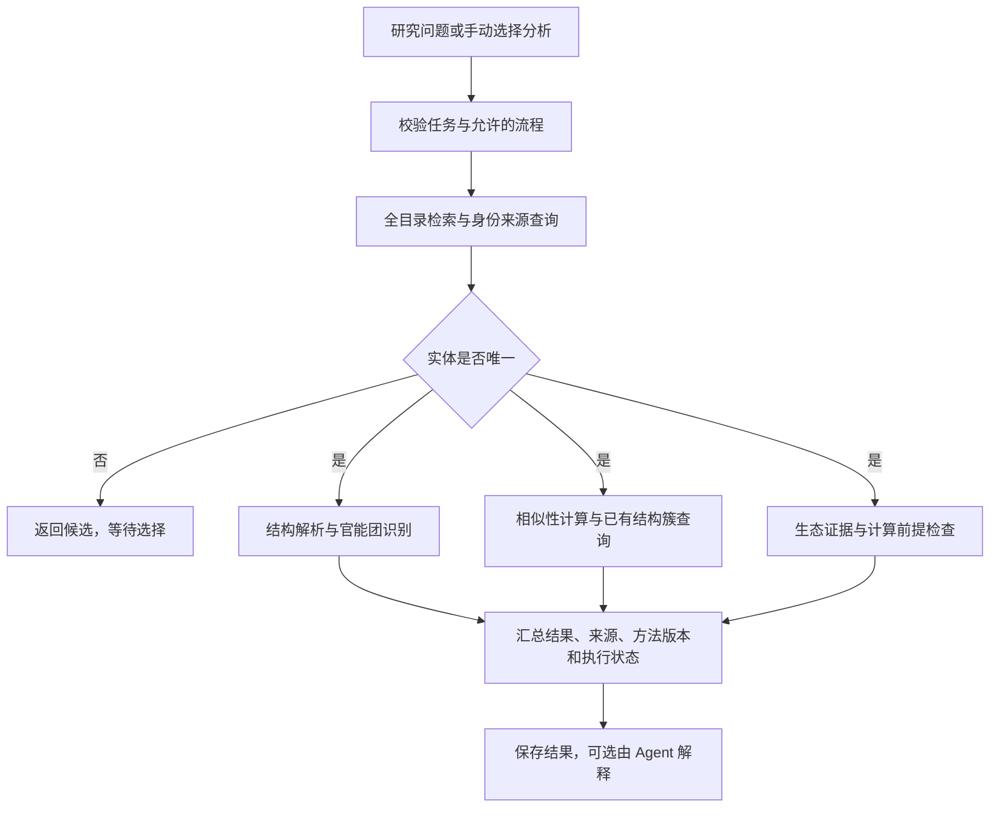

# 新污染物研究工作台

面向新污染物研究的本地分析工具，提供覆盖 1,216 个实体的化学品目录、结构分析、相似物查询和生态证据检索。网页作为操作界面，Python 后台执行分析，SQLite 保存目录、数据来源与复核记录。

研究问答由一个 Agent 调用三条固定工作流完成。分析规则和参数由项目配置控制，Agent 负责理解问题、选择流程和解释结果。目录检索与固定分析无需模型密钥；自然语言问答需配置支持工具调用的模型服务。

## 获取与安装

从 [GitHub 仓库](https://github.com/Charisyy/ec-contaminant-agent) 点击 **Code → Download ZIP** 下载完整项目，也可使用完整交付包。仓库公开，无需协作者权限。

运行环境为 **Windows、Python 3.12（64 位）**，首次安装依赖需要联网。

1. 将完整项目解压到可写文件夹，例如 `D:\Research\ec-agent`，保留 `data`、`inputs`、`src` 等目录。
2. 双击 `setup.cmd`，检测 Python 并创建项目独立环境。缺少对应版本时，参考 [Python Windows 安装说明](https://docs.python.org/3.12/using/windows.html) 安装；已有其他版本可以保留。
3. 安装完成后双击 `start.cmd`，后台就绪后自动打开浏览器，默认地址为 `http://127.0.0.1:8766/`。
4. 使用期间保留启动窗口，结束时按 **Ctrl+C** 停止服务。

请先解压后运行，直接打开 HTML 无法使用后台分析。环境配置完成后，日常使用只需运行 `start.cmd`。服务默认仅供本机访问，其他使用者可下载项目，在自己的电脑上安装。

## 功能与使用

### 目录检索

按名称、CAS 或实体编号搜索，结合类别、采购标记、已测标记和结构状态筛选。各项支持多选：同一项内匹配任一选项，不同项之间同时生效；不选择表示不限。修改筛选后回到第一页，翻页保留选择。

类别旁显示全库数量，列表上方显示当前筛选的匹配数量。“导出全量目录”导出全部实体，不受当前页面筛选限制。

### 结构与证据分析

输入实体编号（如 `EC0872`）、名称或 CAS，选择分析内容。存在多个候选时，先选择具体实体。

| 工作流 | 分析内容 | 主要结果 |
|---|---|---|
| 身份与结构 `structure` | 读取身份来源，解析选定结构，执行固定 SMARTS 规则 | 结构描述符、官能团与片段命中 |
| 相似物与结构簇 `neighbors` | 检查结构，计算相似性，查询已有聚类 | 相似实体、相似度和结构簇信息 |
| 生态证据 `ecology` | 查询既有端点，检查证据与计算前提 | 物种、端点、实验条件、来源和数据缺口 |

可组合运行，也可选择全部分析。材料、混合物或缺少明确结构的对象不会被强行转换为单一分子；结构步骤无法执行时，仍可查询已有生态证据。结果保留已完成步骤、跳过原因、来源、方法版本和实际工具调用记录，可导出 JSON。

### 生态证据查看与导出

实体详情分页展示证据，支持导出完整证据 CSV。固定工作流及问答只返回有限预览与总量，查看全部记录请从实体详情导出。

记录保留端点类型、物种、观察时长、限定符、浓度依据和文献出处，区分待复核、摘要核对及全文核对等状态。原始记录与复核决定分别保存；排除或暂缓记录不计入默认可用证据，但可展开查看依据。完整 CSV 包含原始记录和复核结论，导出数量可能大于可用数量。数据库来源记录不代表每篇原文均已阅读，全文核对也不等于完成全面研究质量评级。

### 研究问答

页面按身份与结构、相似物、生态证据提供推荐问法，点击后可编辑再发送。支持多段本机对话、实体选择、后续追问，以及回答复制和导出。回答中的来源和工具调用可展开查看。

对话记录保存在当前浏览器，最多保留 12 段对话、每段最近 40 条消息；清理浏览器存储后不再保留。明确选定实体后，后续问题可沿用该对象；新建对话或清除对象可重置。独立问候和使用帮助由本地提示回应，页面标明未调用模型。

## 模型设置

在网页的“模型设置”中配置，无需修改代码：

1. 选择 **DeepSeek** 并填写 API Key，或选择 **自定义兼容接口**，填写服务基础地址、模型名称和 Key。自定义模型需支持工具调用；基础地址不包含 `/chat/completions`。
2. 点击“保存设置”，配置立即生效，保存本身不请求模型。
3. 可点击“测试连接”验证基本请求，再提交实际研究问题检查工具调用。连接测试和研究问答可能按服务商规则计费。

Key 仅保存在项目本机 `.env` 文件中，页面及配置查询不回显；真实密钥、运行环境和日志不进入仓库或交付包。更换服务地址时需重新填写 Key，同一地址留空可保留已有 Key。“清除配置”移除模型设置，保留端口等其他本地配置。

“已配置”表示本机设置已保存，“测试连接成功”表示基本请求成功，均不代替实际研究问题验收。模型解释未通过校验但已有工具结果时，页面明确标注并展示固定工具整理；未执行工具时不会生成分析结果。

## 工作流设计



Agent 只调用 `run_research_workflow`，选择目录对象和已登记的流程组合。工具不接受模型传入任意 SQL、数据库路径、SMARTS、科学阈值或批量写入命令。科学参数由 `research_policy.json` 和规则文件管理；全库构建、数据导入及重新聚类保留在独立后台流程中。

模型解释需通过实体、来源和综合分数校验。多个候选与未找到对象的回复依据实际目录结果生成；来源 URL 从本次工具返回的来源记录组装。完整分析 JSON 保存实际执行记录，不把跳过步骤记为已执行。

## 数据与方法

- **目录范围**：覆盖全部 1,216 个实体。47 个采购候选和 172 个已测标记为独立标签，不限制分析范围，也不证明已购买、已检出或存在毒性。
- **身份与结构**：1,108 个实体已有选定结构，结构匹配不等于人工确认化学身份。保留材料、混合物、多候选及结构歧义；原始结构和来源可追溯，母体选择与盐型处理仍需结合研究目的审查。
- **官能团识别**：运行时采用 SMARTS 规则 1.2，共 17 条有限片段规则。命中不构成毒性判断，匹配次数不一定等于独立官能团个数，芳香原子数不等于芳香环数。目录页历史缓存与工作流实时结果分别标注，避免混用。
- **相似性与聚类**：Morgan 指纹半径 2、2,048 位、保留手性；查询已有 Butina 距离阈值 0.4 的聚类快照。参数、软件版本或输入摘要不一致时标为历史记录，不自动重聚类。结构相似不代表毒性等效，结构簇不代表风险组。
- **生态证据**：EPA 水生基准、PNEC、LC50、EC50 等保留各自类型及适用条件，不直接混合比较。当前未接入生态毒性预测模型。
- **暴露与风险**：随包数据库没有环境暴露浓度记录，不生成综合环境风险排名。逐端点计算仅在身份、暴露及端点可比条件满足时执行。

数据筛选与来源详见[生态证据整理记录](docs/生态证据扩充_20261019.md)，核对依据详见[文献原文复核记录](docs/原文复核_20261019.md)。

## 命令行与验证

在项目文件夹中运行：

```powershell
.venv\Scripts\python.exe -m ec_agent.cli analyze EC0872 --workflow structure
.venv\Scripts\python.exe -m ec_agent.cli analyze EC0872 --workflow neighbors
.venv\Scripts\python.exe -m ec_agent.cli analyze EC0872 --workflow ecology
.venv\Scripts\python.exe -m ec_agent.cli analyze EC0872
```

省略 `--workflow` 时运行全部三条流程，结果保存在 `outputs/analyses/运行编号/result.json`。`trace` 记录实际执行步骤，`skipped_steps` 记录未执行步骤。添加 `--llm-review` 可让 Agent 解释已保存的固定流程结果，模型失败不影响本地结果保留。

环境检查、回归测试与离线验收：

```powershell
.\setup.cmd --check
.venv\Scripts\python.exe -B check_environment.py
.venv\Scripts\python.exe -B -m pytest -q
.venv\Scripts\python.exe scripts/validate_release.py
```

离线验收覆盖官能团正反例及七种固定流程情形，结果保存在 `outputs/acceptance`，不请求模型。测试写入及合成暴露使用临时数据库。离线通过不代表所有模型服务兼容，也不替代科学审阅；真实模型验收范围与结果见[模型验收清单](docs/模型验收清单.md)和[真实模型验收记录](docs/真实模型验收_20261019.md)。

## 常见问题

| 问题 | 处理方式 |
|---|---|
| 已安装 Python，仍提示版本不符合 | 运行 `setup.cmd --check`，确认存在 Python 3.12（64 位）；其他版本可以同时保留 |
| 缺少依赖或 `crewai` | 运行 `setup.cmd` 完成安装，再运行 `start.cmd` |
| 浏览器未打开或无法访问 | 查看启动窗口是否报错；服务就绪后手动访问窗口显示的地址 |
| 关闭窗口后无法查询 | 重新运行 `start.cmd`，使用期间保留窗口 |
| 提示缺少数据库 | 检查是否完整解压，启动程序不会自动重建数据库 |
| 端口被占用 | 在本机 `.env` 设置 `EC_AGENT_PORT` 后重启 |
| 研究问答不可用 | 检查“模型设置”及服务权限；目录与固定流程仍可独立使用 |
| 分析请求失败 | 根据页面错误与日志编号排查，日志位于 `outputs/logs/server.log` |

设计和方法文档：[Agent 搭建说明](Agent搭建说明.md)、[方法与接口登记](docs/方法与接口登记.md)、[官能团规则校核](docs/官能团规则校核.md)。
