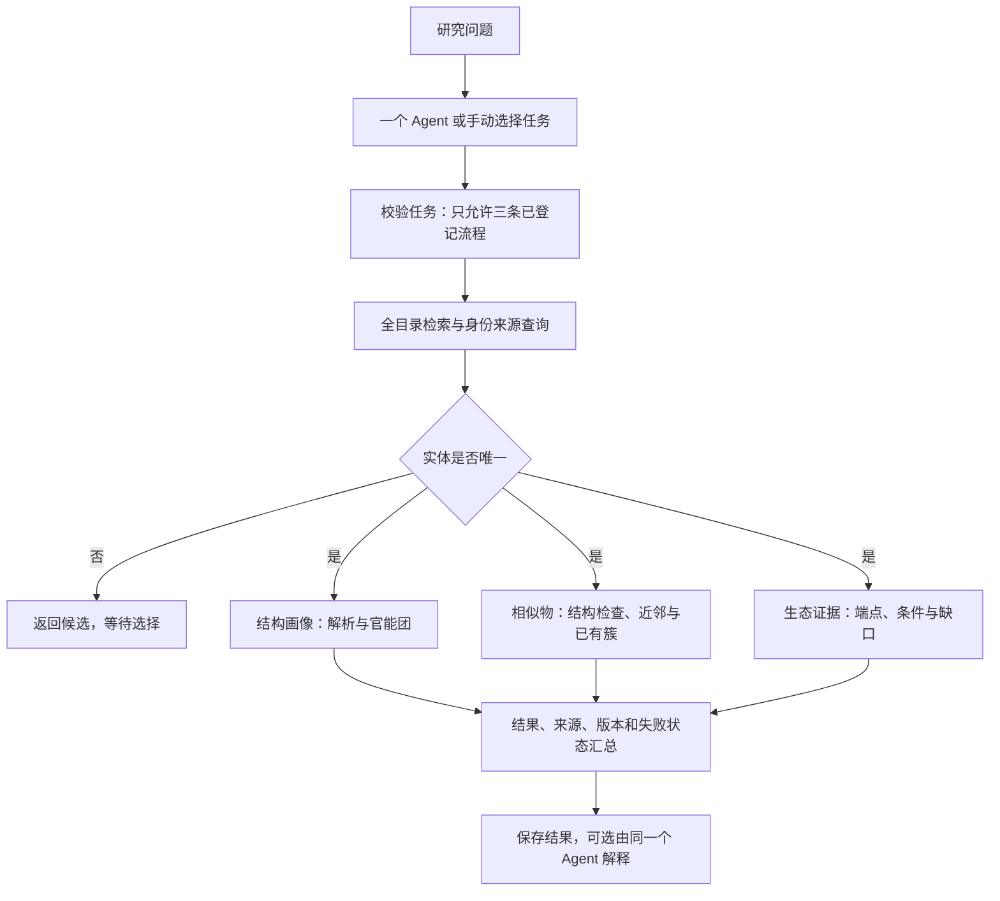

# 新污染物研究工作台

一个 Agent、三条固定研究工作流和一个覆盖全部 1,216 个实体的 SQLite 目录。网页用于操作和查看结果，Python 后台执行工具，数据库保存目录及来源记录。

当前版本为科研原型，功能范围为目录检索、身份与结构核查、官能团分析、结构相似性与聚类，以及已有生态证据整理。固定流程不需要模型密钥；自然语言问答需要单独配置并验证模型服务。

## Windows 快速使用

1. 将整个项目解压到可写文件夹，例如 `D:\Research\ec-agent`，保留 `data`、`inputs`、`src` 等目录。不要在压缩包预览中启动程序，也不要只打开 HTML。
2. 运行环境要求 **Python 3.12（64位）**。双击 `setup.cmd`，脚本会查找可用解释器并创建项目独立环境；首次安装依赖需要联网。如果缺少对应版本，按 [Python Windows 文档](https://docs.python.org/3.12/using/windows.html) 安装，已有其他版本可以保留。
3. 安装完成后双击 `start.cmd`。后台就绪后自动打开浏览器，默认地址为 `http://127.0.0.1:8766/`。
4. 打开“结构与证据分析”，输入 `EC0872` 或名称，选择结构与官能团、相似物与结构簇、生态证据或全部分析。
5. 点击“导出结果 JSON”，保留来源、方法版本和实际调用记录。使用期间保留启动窗口，结束时按 Ctrl+C。

此版本需要首次安装运行环境，尚未提供免安装 EXE。环境配置完成后，日常固定流程无需重复安装依赖。

## 环境检查与常见问题

安装脚本依次检查 Python 启动器、命令路径和当前用户已有的 Codex Python 运行环境，仅使用符合版本与位数要求的解释器创建项目环境。原有解释器保持不变。

```powershell
.\setup.cmd --check
```

此命令仅检查解释器，不安装依赖。安装了 Python 3.14 等其他版本仍可能无法满足本项目的 3.12 要求；错误提示会列出启动器已登记的版本。

| 问题 | 处理方式 |
|---|---|
| 提示缺少运行环境 | 先运行 `setup.cmd`，确认安装完成后再启动 |
| 浏览器未自动打开 | 查看启动窗口的错误信息；服务就绪后可手动访问 `http://127.0.0.1:8766/` |
| 关闭启动窗口后无法查询 | 重新运行 `start.cmd`；使用期间保留启动窗口 |
| 提示缺少数据库 | 完整解压项目；启动程序不会自动重建数据库 |
| 端口被占用 | 在本地 `.env` 设置 `EC_AGENT_PORT` 后重启，或检查端口占用情况 |
| 研究问答不可用 | 在“模型设置”中保存接口与 Key；不影响目录检索和固定分析流程 |
| 依赖安装失败 | 保留安装窗口的错误信息和 Python 版本，供排查使用 |
| 提示缺少 `crewai` | 运行 `setup.cmd` 完成依赖安装，再使用 `start.cmd` 启动；已有项目环境时 `launch.py` 会自动切换解释器 |
| 分析请求失败 | 页面显示具体错误或日志编号；日志位于 `outputs/logs/server.log` |

默认服务仅供本机访问。其他用户需要取得完整项目并在自己的电脑上安装；共享本机地址不会提供远程访问。

## 目录多选筛选

一级类别、采购标记、已测标记和结构状态均可展开后勾选多个值。同一筛选内匹配任一选项，不同筛选同时生效；未勾选表示不限，二选项同时勾选也表示包含两种状态。类别旁的数量为全库数量，表格上方显示当前组合的匹配数量。

修改筛选会回到第一页；翻页保留选择。每个下拉框可单独清空，“重置筛选”清除搜索、全部勾选和结构簇/官能团限定。多选只影响目录查询，无需模型服务。

顶部“导出全量目录”始终导出全部实体，当前筛选仅作用于页面列表。目录详情中的官能团及片段筛选均为历史缓存；需要当前规则结果时使用“结构与证据分析”。

## 三条工作流

共同入口：全目录检索 → 唯一实体定位 → 身份、候选结构与证据读取。

| 流程 | 工具链 | 用途 |
|---|---|---|
| `structure` | 结构解析 → 固定 SMARTS 匹配 | 身份与结构画像 |
| `neighbors` | 结构检查 → 相似性 → 已有结构簇查询 | 寻找结构相近对象，查看分组 |
| `ecology` | 生态证据与计算前提检查 | 整理记录和缺口 |

重名需要用户选择；材料、多候选或缺结构不会被强行转换成单一分子。结构分支受阻时，生态证据查询仍可运行。工具失败保留已完成结果，跳过的步骤不会伪装成已执行。



模型只配备 `run_research_workflow` 一个工具。它能选择对象和流程组合，不能传入任意 SMILES、SMARTS、阈值、数据库路径、SQL 或批量写入命令。科学参数由 `research_policy.json` 与规则文件控制，不由 Agent 临时生成。

## 命令行使用

以下命令在项目文件夹运行：

```powershell
.venv\Scripts\python.exe -m ec_agent.cli analyze EC0872 --workflow structure
.venv\Scripts\python.exe -m ec_agent.cli analyze EC0872 --workflow neighbors
.venv\Scripts\python.exe -m ec_agent.cli analyze EC0872 --workflow ecology
.venv\Scripts\python.exe -m ec_agent.cli analyze EC0872 --workflow structure --workflow ecology
.venv\Scripts\python.exe -m ec_agent.cli analyze EC0872
```

省略 `--workflow` 时运行全部三条流程。结果保存在 `outputs/analyses/运行编号/result.json`。`trace` 是真实工具执行记录，`skipped_steps` 是未执行步骤，二者分开。

## 数据和方法边界

- 目录覆盖 1,216 个实体；47 个采购候选和172个已测标记是独立标签，不限制分析范围，也不证明已经购买、检出或有毒。
- 已有1,108个选定结构不等于化学身份已经确认；材料、混合物和结构歧义保留。
- 本次携带数据库与原压缩包字节一致，没有重建数据库、导入新暴露或重算全库。
- 运行时使用固定 SMARTS **1.2**，其中硝基规则采用 RDKit 官方 Nitro 模式，区分硝基与硝酸酯；数据库目录页中的官能团仍是历史缓存。工作流重新计算并标注新旧版本，不混合统计。
- 17条 SMARTS 是项目有限片段规则，并不构成完整化学分类或经过生态毒性验证的警报规则。其余规则保留原有定义；42 个正反例及边界样例见 validation/functional_group_cases.json。匹配次数不等于独立官能团个数，详细边界见 docs/官能团规则校核.md。
- 芳香原子数不是芳香环数。相似性不是毒性等效；结构簇不是风险组。
- 相似性沿用 Morgan 半径2、2048位、保留手性；查询既有 Butina 距离0.4快照。聚类还检查参数、软件版本及输入摘要，不一致时标为历史记录，不自动重聚类。
- 原结构保留，现有母体策略仍须研究者进一步审查；本次没有新增去盐、中和或互变异构处理。
- EPA水生基准、PNEC、LC50、EC50分别保留类型。没有暴露数据时不生成综合环境风险排名。
- 既有逐端点筛查器仅在身份、暴露和端点条件满足时计算；当前随包数据库没有暴露记录。

## 模型配置与研究问答

研究问答采用对话式界面。首页按“身份与结构、相似物、生态证据”提供 6 个推荐问法；点击后填入输入框，可编辑后发送。推荐问法和后续追问均为本地模板，点击不会自动调用模型。示例只覆盖当前工具支持的目录、结构和证据任务。

左侧可新建、切换最近对话；输入框支持 Enter 发送、Shift+Enter 换行。回答可复制、导出，并展开查看来源与实际工具调用记录。等待时只显示真实等待时长，不模拟推理过程或工具进度。

对话记录保存在当前浏览器中，最多保存 12 段对话、每段最近 40 条消息。可清除本机记录；换浏览器或清理浏览器存储后不会保留。导出的对话保存显示内容与调用摘要；完整分析 JSON 仍位于项目 `outputs/analyses`。本轮结果在当前页面可单独导出；恢复历史后的本轮导出使用已保存的对话摘要。

成功定位单个实体后，页面显示当前研究对象，后续问题可沿用该实体。模型接收当前问题和经过目录核验的实体编号、名称、CAS，不会把全部历史回答作为事实重新传入。新建对话或点击“清除对象”可重置。多个候选仍需明确选择；编号无效时先停止，不请求模型。

交互参考：[Flowise 推荐问法与聊天窗口](https://docs.flowiseai.com/using-flowise/embed)、[Open WebUI 聊天交互](https://docs.openwebui.com/features/chat-conversations/chat-features/)。页面代码为本项目实现，未引入这些平台作为运行依赖。

在网页的“模型设置”中配置，无需修改代码或手工编辑文件：

1. 选择 **DeepSeek**，填写 API Key 并保存。该预设使用 `deepseek-flash` 和 `https://api.deepseek.com`，按 [DeepSeek 官方接口文档](https://api-docs.deepseek.com/zh-cn/) 配置。
2. 其他兼容服务选择 **自定义兼容接口**，填写基础地址、模型名称及 Key。基础地址例如 `https://example.com/v1`，不填写 `/chat/completions`；模型需支持工具调用。
3. 保存后立即生效。可直接进入“研究问答”，也可先点击“测试连接”。测试会发出少量模型请求，可能按服务商规则计费；保存设置不会调用模型。

Key 保存在当前项目的本地 `.env` 文件中，页面和配置查询不回显。更换服务地址需要重新填写 Key；同一地址留空可保留已有 Key。“清除配置”移除模型设置，保留端口等其他本地配置。`.env`、临时配置文件、环境与运行日志均不进入仓库或交付包。

“测试连接”仅验证基本模型请求；工具调用、科学结论和具体服务的兼容性仍应通过实际问题核查。配置保存、工具调用、结果校验及浏览器链路已完成本地模拟测试；另经用户授权执行了七个真实问题，原轮结果与修复后尚待复验的状态见下文。

“你好”“谢谢”等独立问候，以及明确的使用帮助，会由本地固定提示回应，标明“未调用模型”。包含实体与分析任务的研究问题仍需模型执行固定工具流程；不会放宽实体、来源和风险分数校验。

DeepSeek 预设显式使用非思考模式执行工具调用，基础连接测试使用相同设置。默认思考模式的多步调用需要续传额外字段，详见 [DeepSeek 思考模式与工具调用说明](https://api-docs.deepseek.com/guides/thinking_mode/)。当前适配器使用其非思考调用方式。

问答错误区分“模型请求失败”和“回答校验失败”，分别返回接口状态或具体核查原因，并附错误编号。错误日志不保存 Key、问题正文和模型原始错误内容。界面显示“已配置”仅表示本地设置已保存。

`analyze EC0872 --llm-review` 先保存固定流程结果，再让同一个 Agent 解释这份结果，不重新运行另一套分析。模型失败时本地结果仍保留。独立检查确保模型执行过流程、引用的实体和URL来自本次结果、综合分数为空；这不替代对自然语言科学结论的审阅。

## 测试与维护

```powershell
.venv\Scripts\python.exe -B check_environment.py
.venv\Scripts\python.exe -B -m pytest -q
```

测试中的写入和合成暴露只进入临时数据库，交付数据库保持原样。全库构建、导入和重聚类命令仍在独立后台流程中，不开放给问答 Agent；日常使用无需运行 `run_all.cmd`。

更多设计见 [Agent搭建说明](Agent搭建说明.md)、[方法与接口登记](docs/方法与接口登记.md)。

## 获取与共享

GitHub 仓库为私有仓库。协作者需由仓库所有者授予访问权限，登录后可下载完整 ZIP 并按上述步骤安装。也可直接分发完整交付包。

项目不包含本机 `.venv`、`.env` 或真实密钥。运行环境由每位使用者在本机创建；模型凭据应保存在本机，不提交到仓库。

## 离线验收

运行 `.venv\Scripts\python.exe scripts/validate_release.py` 检查规则正反例与七种固定流程情形，结果保存在 `outputs/acceptance`。命令不请求模型、不读取 Key、不修改目录。真实模型验收问题及判定标准见 [模型验收清单](docs/模型验收清单.md)；真实服务的原轮执行结果另见下文记录。

## 真实模型验收与校验失败处理

2026-10-19 经授权使用 DeepSeek deepseek-flash 提交七个问题，0.2.7 原轮结果为三项正常返回、四项被校验拦截，详见 [真实模型验收记录](docs/真实模型验收_20261019.md)。未把该轮记为全部通过。

0.2.8 保留实体、来源和综合分数校验。模型解释被拒绝且已有实际工具结果时，页面明确标注并展示固定工具整理；不展示被拒绝的解释，不追加模型请求。候选选择和未找到对象仍保留。服务失败或未执行工具时继续报错，不伪造分析。修复已通过离线测试，尚未重新调用真实服务复验。

## 目录状态与来源契约

0.2.9 中多个候选及未找到对象由实际目录结果生成回复，保留选择和追问。模型仅选择工具返回的来源编号，完整 URL 由程序从本轮来源记录组装；不接受不存在或属于其他实体的编号，正文中的越界链接同样拦截。未被接受的模型解释仍使用实际工具结果整理并标注。

原轮真实验收结果保留，不因本轮离线测试通过而改成真实验收通过。本轮没有追加计费请求。
