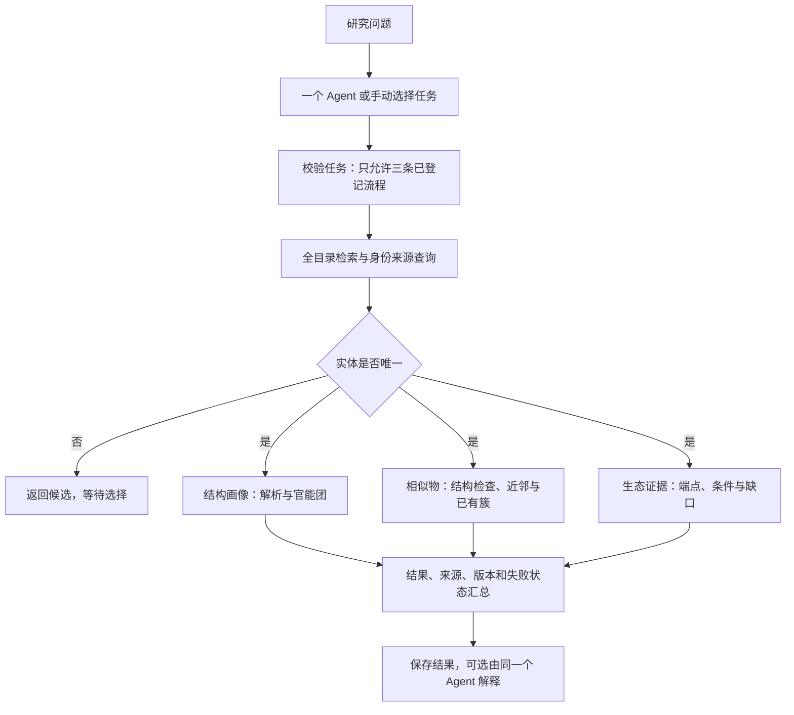

# 新污染物研究工作台

一个 Agent、三条固定研究工作流和一个覆盖全部 1,216 个实体的 SQLite 目录。网页用于操作和查看结果，Python 后台执行工具，数据库保存目录及来源记录。

这是科研原型，不是已经完成验证的生态毒性预测平台。固定流程不需要模型密钥；自然语言问答需要本机模型配置。本次更新没有调用付费模型 API，也没有接入毒性预测模型。

## Windows 快速使用

1. 完整解压项目，保留 `data`、`inputs`、`src` 等文件夹。不要只打开 HTML。
2. 首次使用安装 **Python 3.12（64位）**，然后双击 `setup.cmd`。首次安装依赖需要联网。
3. 安装完成后双击 `start.cmd`。后台就绪后自动打开浏览器，默认地址为 `http://127.0.0.1:8766/`。
4. 打开“分析工作流”，输入 `EC0872`，选择结构画像、相似物与分组、生态证据或综合分析。
5. 点击下载本次结果，保留来源、方法版本和实际调用记录。使用期间保留启动窗口，结束时按 Ctrl+C。

详细说明见 [师兄使用说明](师兄使用说明.md)。此版本需要首次安装运行环境，尚未制作免安装 EXE。

## 三条工作流

共同入口：全目录检索 → 唯一实体定位 → 身份、候选结构与证据读取。

| 流程 | 工具链 | 用途 |
|---|---|---|
| `structure` | 结构解析 → 固定 SMARTS 匹配 | 身份与结构画像 |
| `neighbors` | 结构检查 → 相似性 → 已有结构簇查询 | 寻找结构相近对象，查看分组 |
| `ecology` | 生态证据与计算前提检查 | 整理记录和缺口 |

重名需要用户选择；材料、多候选或缺结构不会被强行转换成单一分子。结构分支受阻时，生态证据查询仍可运行。工具失败保留已完成结果，跳过的步骤不会伪装成已执行。



模型只配备 `run_research_workflow` 一个工具。它能选择对象和流程组合，不能传入任意 SMILES、SMARTS、阈值、数据库路径、SQL 或批量写入命令。科学参数由 `research_policy.json` 与规则文件控制，不由 Agent 临时生成。

## 命令行使用

以下命令在项目文件夹运行：

```powershell
.venv\Scripts\python.exe -m ec_agent.cli analyze EC0872 --workflow structure
.venv\Scripts\python.exe -m ec_agent.cli analyze EC0872 --workflow neighbors
.venv\Scripts\python.exe -m ec_agent.cli analyze EC0872 --workflow ecology
.venv\Scripts\python.exe -m ec_agent.cli analyze EC0872 --workflow structure --workflow ecology
.venv\Scripts\python.exe -m ec_agent.cli analyze EC0872
```

省略 `--workflow` 时运行全部三条流程。结果保存在 `outputs/analyses/运行编号/result.json`。`trace` 是真实工具执行记录，`skipped_steps` 是未执行步骤，二者分开。

## 数据和方法边界

- 目录覆盖 1,216 个实体；47 个采购候选和172个已测标记是独立标签，不限制分析范围，也不证明已经购买、检出或有毒。
- 已有1,108个选定结构不等于化学身份已经确认；材料、混合物和结构歧义保留。
- 本次携带数据库与原压缩包字节一致，没有重建数据库、导入新暴露或重算全库。
- 运行时沿用项目已修正的 SMARTS **1.1**；数据库目录页中的官能团仍是历史缓存。工作流重新计算并标注新旧版本，不混合统计。
- 17条 SMARTS 是项目有限片段规则，并不构成完整化学分类或经过生态毒性验证的警报规则。修正来自原项目现有规则文件，本次没有另造科学规则。
- 芳香原子数不是芳香环数。相似性不是毒性等效；结构簇不是风险组。
- 相似性沿用 Morgan 半径2、2048位、保留手性；查询既有 Butina 距离0.4快照。聚类还检查参数、软件版本及输入摘要，不一致时标为历史记录，不自动重聚类。
- 原结构保留，现有母体策略仍须研究者进一步审查；本次没有新增去盐、中和或互变异构处理。
- EPA水生基准、PNEC、LC50、EC50分别保留类型。没有暴露数据时不生成综合环境风险排名。
- 既有逐端点筛查器仅在身份、暴露和端点条件满足时计算；当前随包数据库没有暴露记录。

## 可选模型入口

项目不包含 `.env` 或任何真实密钥。本地配置后才能使用“Agent问答”或 `ask`。保留原服务配置接口，未在此次工作中接通或验证真实模型。

`analyze EC0872 --llm-review` 先保存固定流程结果，再让同一个 Agent 解释这份结果，不重新运行另一套分析。模型失败时本地结果仍保留。独立检查确保模型执行过流程、引用的实体和URL来自本次结果、综合分数为空；这不替代对自然语言科学结论的审阅。

## 测试与维护

```powershell
.venv\Scripts\python.exe -B check_environment.py
.venv\Scripts\python.exe -B -m pytest -q
```

测试中的写入和合成暴露只进入临时数据库，交付数据库保持原样。全库构建、导入和重聚类命令仍在独立后台流程中，不开放给问答 Agent；日常使用无需运行 `run_all.cmd`。

更多设计见 [Agent搭建说明](Agent搭建说明.md)、[方法与接口登记](docs/方法与接口登记.md)。GitHub 仓库按私有方式交付；师兄需要账号访问权限后才能直接下载仓库。
